# Solver Wave 4: MultiTransport & Stefan–Maxwell Dependency Graph

This document details the algorithmic, data, and cache dependency structure of Cantera's **MultiTransport / Stefan–Maxwell** multicomponent transport solver stack, reconstructed directly from pinned Cantera C++ sources (`src/transport/MultiTransport.cpp`, `src/transport/GasTransport.cpp`, `src/transport/MMCollisionInt.cpp`).

---

## 1. Architectural Call & Data Flow Graph

```mermaid
flowchart TD
    subgraph Phase1["Phase 1: Kinetic Theory Initialization & Fitting"]
        TD["TransportData\n(sigma, epsilon, dipole, polarizability, zrot, crot)"]
        SCP["GasTransport::setupCollisionParameters()\n(Reduced mass, effective d_ij, eps_ij, delta_ij)"]
        MPC["GasTransport::makePolarCorrections()\n(Polar-nonpolar correction factors f_eps, f_sigma)"]
        MM["MMCollisionInt::init(tsmin, tsmax)\n(Monchick & Mason Stockmayer Tables)"]
        FCI["GasTransport::fitCollisionIntegrals()\n(Polynomial fits for A*, B*, C*, omega22)"]
        FP["GasTransport::fitProperties()\n(Pure-species viscosity & conductivity fits)"]
        FDC["GasTransport::fitDiffCoeffs()\n(Unit-pressure binary diffusion fits)"]

        TD --> SCP
        SCP --> MPC
        MPC --> MM
        MM --> FCI
        FCI --> FP
        FP --> FDC
    end

    subgraph Phase2["Phase 2: Runtime State Evaluation & Caching"]
        STATE["ThermoPhase State\n(T, P, X_k, Y_k, rho)"]
        UT["update_T()\n(Compute T, logT, sqrtT, powers)"]
        UC["update_C()\n(Compute X_k with Tiny offset, check delta_X)"]
        USV["updateSpeciesViscosities()\n(eta_k via poly fits)"]
        UDT["updateDiff_T()\n(Binary D_ij(1 Pa) via poly fits)"]
        UTT["updateThermal_T()\n(A*, B*, C* fits, rotrelax via Frot, self-diff D_kk, cinternal)"]

        STATE --> UT
        STATE --> UC
        UT --> USV
        UT --> UDT
        UT --> UTT
    end

    subgraph Phase3["Phase 3: The 3K x 3K Block L-Matrix System"]
        L0000["eval_L0000(X)\n[K x K upper-left]"]
        L0010["eval_L0010(X)\n[K x K upper-mid]"]
        L0001["eval_L0001() = 0\n[K x K upper-right]"]
        L1000["eval_L1000() = L0010^T\n[K x K mid-left]"]
        L1010["eval_L1010(X)\n[K x K mid-mid]"]
        L1001["eval_L1001(X)\n[K x K mid-right]"]
        L0100["eval_L0100() = 0\n[K x K lower-left]"]
        L0110["eval_L0110() = L1001^T\n[K x K lower-mid]"]
        L0101["eval_L0101(X)\n[K x K lower-right]"]

        RHS["RHS Vector b\n(b[0:K]=0, b[K:2K]=X, b[2K:3K]=X if has_internal)"]
        SOLVEL["solveLMatrixEquation()\nSolve L * a = b for unknown vector a"]

        UTT --> L0000
        UTT --> L0010
        UTT --> L1010
        UTT --> L1001
        UTT --> L0101
        L0010 --> L1000
        L1001 --> L0110
        L0000 & L0010 & L0001 & L1000 & L1010 & L1001 & L0100 & L0110 & L0101 & RHS --> SOLVEL
    end

    subgraph Phase4["Phase 4: Multicomponent Transport Solvers"]
        COND["thermalConductivity()\nlambda = -4 * sum(b_{K+k} * a_{K+k})"]
        TDIFF["getThermalDiffCoeffs(dt)\nD_k^T = (1.6 / R) * M_k * X_k * a_k"]
        MDIFF["getMultiDiffCoeffs(d)\nInvert L0000 -> D_ij via prefactor & diagonal delta"]
        SM["getSpeciesFluxes(fluxes)\nStefan-Maxwell Matrix A_ij\nRow substitution: A_{jmax, j} = Y_j\nSolve A * V = grad_X\nj_k = (rho Y_k / P) * V_k - D_k^T (gradT / T)"]
        VISC["viscosity()\nWilke Mixture Rule with Poling Phi Matrix"]

        SOLVEL --> COND
        SOLVEL --> TDIFF
        L0000 --> MDIFF
        UDT & TDIFF & STATE --> SM
        USV & STATE --> VISC
    end
```

---

## 2. Component Dependency Specifications

### 2.1 Initialization Stack
1. **`setupCollisionParameters()`**:
   - Reads pure species parameters from `GasTransportData` (`diameter` $\sigma_k$, `well_depth` $\epsilon_k/k_B$, `dipole` $\mu_k$, `polarizability` $\alpha_k$, `rotational_relaxation` $Z_{\mathrm{rot}, k}$, `geometry` $\to c_{\mathrm{rot}, k}$).
   - Constructs pair collision matrices: reduced mass $m_{ij}$, hard-sphere diameter $\sigma_{ij} = \frac{1}{2}(\sigma_i + \sigma_j)$, effective well depth $\epsilon_{ij} = \sqrt{\epsilon_i \epsilon_j}$, effective dipole $\mu_{ij} = \sqrt{\mu_i \mu_j}$, reduced dipole $\delta_{ij}^* = \frac{\mu_{ij}^2}{8 \pi \epsilon_0 \epsilon_{ij} \sigma_{ij}^3}$.
   - Invokes `makePolarCorrections(i, j, f_eps, f_sigma)` to adjust $\sigma_{ij}$ and $\epsilon_{ij}$ for polar-nonpolar interactions.
2. **`setupCollisionIntegral()`**:
   - Determines reduced temperature bounds $T^*_{\min}, T^*_{\max}$ across all pairs.
   - Initializes `MMCollisionInt` with Stockmayer tables.
   - Fits collision integral polynomials ($A^*, B^*, C^*, \Omega^{(2,2)*}$) of degree 8 (or degree 6 in Chemkin mode).
3. **`fitProperties()` & `fitDiffCoeffs()`**:
   - Samples 50 logarithmically spaced temperatures between $T_{\min}$ and $T_{\max}$.
   - Evaluates pure species viscosities $\eta_k$, conductivities $\lambda_k$, and unit-pressure binary diffusivities $\mathcal{D}_{ij}$.
   - Fits Chebyshev/monomial polynomials in $\ln T$ (degree 4, weighted).

### 2.2 Runtime State & Invalidation Cache
- **`m_temp` / `m_thermal_tlast`**: Guards temperature changes. When $T$ changes, flags `m_visc_ok`, `m_spvisc_ok`, `m_viscwt_ok`, `m_bindiff_ok`, `m_l0000_ok`, `m_lmatrix_soln_ok` are set to `false`.
- **`m_molefracs`**: Updated with $X_k = \max(\text{Tiny}, X_k)$. If any $X_k$ differs from `m_molefracs_last`, `m_l0000_ok` and `m_lmatrix_soln_ok` are invalidated.

### 2.3 The 3K x 3K L-Matrix System
The thermal conductivity and thermal diffusion coefficients are determined by solving:
$$
\mathbf{L} \mathbf{a} = \mathbf{b}
$$
where:
- $\mathbf{a} = [a_1, \dots, a_K, a_{K+1}, \dots, a_{2K}, a_{2K+1}, \dots, a_{3K}]^T$.
- Block 1 ($1 \dots K$): translational terms associated with diffusion.
- Block 2 ($K+1 \dots 2K$): translational thermal conduction terms.
- Block 3 ($2K+1 \dots 3K$): internal energy mode conduction terms.
- For species with no internal modes ($c_{\mathrm{int}, k} \le 10^{-3}$), row/column in Block 3 are set to identity ($L_{2K+k, 2K+k} = 1.0$) and $b_{2K+k} = 0$, decoupling the unphysical mode.

### 2.4 Stefan–Maxwell Flux System
The diffusive velocities $V_k$ satisfy:
$$
\sum_{j=1}^K \frac{X_i X_j}{\mathcal{D}_{ij}} (V_j - V_i) = \nabla X_i
$$
Subject to the exact mass conservation constraint:
$$
\sum_{k=1}^K Y_k V_k = 0
$$
To eliminate the rank-1 singularity, Cantera replaces the row $j_{\max} = \mathrm{argmax}_j |\nabla X_j|$ with the mass fractions:
$$
A_{j_{\max}, j} = Y_j, \quad \text{RHS}_{j_{\max}} = 0
$$
The linear system $A \mathbf{V} = \nabla X$ is solved, and the mass fluxes are formed:
$$
j_k = \frac{\rho Y_k}{P} V_k - D_k^T \frac{\nabla T}{T}
$$
ensuring $\sum_{k=1}^K j_k = 0$ to machine precision.
